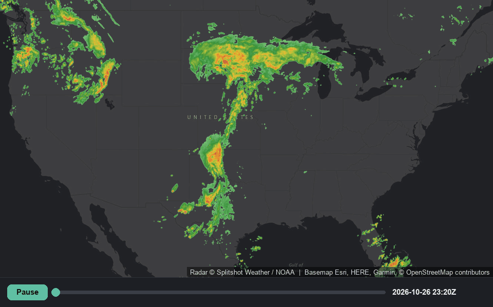

# Splitshot Weather — map starter

Animated US weather radar on a map, in one HTML file and about 80 lines of
JavaScript. No build step, no framework, no bundler.



<sub>Real tiles from the API, composited at full colour depth. The basemap
under them is Esri's dark canvas; `index.html` ships with CARTO's, so your
ground will look slightly different. The radar is identical.</sub>

Built on the [Splitshot Weather API](https://splitshotweather.com) — NOAA radar,
rainfall, lightning, wind and temperature rendered as map tiles, plus
point forecasts and
history. This repo is the shortest path from an API key to something moving on a
screen.

## Run it

1. **Get a key.** [splitshotweather.com](https://splitshotweather.com) — the
   trial is free and takes no card. Current limits are on the
   [pricing page](https://splitshotweather.com/#pricing).
2. **Paste it into `config.js`**, replacing `PASTE_YOUR_KEY_HERE`.
3. **Serve the folder** and open it:

   ```sh
   python3 -m http.server 8000
   # then open http://localhost:8000
   ```

Opening `index.html` directly as a `file://` URL will not work. `index.html`
uses an ES module to import `config.js`, and browsers refuse module imports over
`file://`. Any static server will do — the one-liner above, `npx serve`,
whatever you already run.

## How the API works

Two calls. Read the manifest, then load tiles.

**The manifest tells you which frames exist right now:**

```sh
curl -H "x-api-key: YOUR_KEY" \
  https://api.splitshotweather.com/manifest/composite.json
```

```jsonc
{
  "product": "composite",
  "cadenceMinutes": 5,
  "maxZoom": 8,
  "units": "dBZ",
  "frames": ["20261026-1945", "20261026-1950", ...],  // observed, oldest first
  "latest": "20261026-2140",
  "forecast": [{ "ts": "20261026-2145", "leadMinutes": 5 }, ...],
  "tileUrlTemplate": "/tiles/composite/{ts}/{z}/{x}/{y}.png",
  "forecastTileUrlTemplate": "/tiles/composite-fcst/{ts}/{z}/{x}/{y}.png",
  "legend": [{ "value": 5.0, "unit": "dBZ", "rgb": [126, 211, 126] }, ...]
}
```

Always read the manifest rather than deriving timestamps from the clock. Frames
are published when the upstream data lands, which is not on a tidy schedule, and
a guessed timestamp is a 404.

**Then substitute a timestamp into the template** and hand the result to your map
library as a raster source. That is all `index.html` does.

The `legend` array is the exact colour ramp the tiles were rendered with, so a
legend in your UI can be generated from it instead of hard-coded and drifting.

### Two ways to pass the key

| | |
|---|---|
| `x-api-key: YOUR_KEY` header | Use this wherever you control the request — the manifest fetch, `/forecast`, `/history`. |
| `?key=YOUR_KEY` query string | For raster tiles, where the map engine issues the request and gives you no way to attach a header. |

The key is stripped at the edge before anything is cached or logged, and the
tile cache key ignores it, so every customer shares one cached tile.

### Other endpoints

```
GET /manifest/{product}.json
GET /tiles/{product}/{ts}/{z}/{x}/{y}.png
GET /forecast/{lat},{lon}
GET /history/{lat},{lon}/{iso8601}
GET /points/lightning/{ts}.json      lightning as GeoJSON points
GET /alerts                          active NWS alerts, as GeoJSON
GET /alerts/{lat},{lon}              just the ones over one point
```

Products: `composite` (radar reflectivity), `qpe-1h` and `qpe-24h` (rainfall
accumulation), `lightning`, `wind`, `temperature`. Each has its own manifest, legend and
cadence — change `PRODUCT` in `config.js` to try one.

Full reference: [splitshotweather.com/docs.html](https://splitshotweather.com/docs.html)

## Two things worth copying

**Mount every frame, switch opacity.** The obvious approach — one source whose
URL you rewrite on each step — makes the map tear down and refetch the entire
tile set every time, so scrubbing flickers and burns requests re-downloading
frames you just had. Mounting each frame as its own layer and flipping
`raster-opacity` is a GPU operation on tiles already in memory.

The cost is that all frames load up front. At 24 observed frames that is real,
so a production app usually mounts a window around the current frame rather than
the whole timeline.

**A dark basemap.** The radar ramp starts at light green. On a light basemap the
weak returns — which are most of the pixels — wash out completely.

## Before you ship this

`config.js` puts the key in front-end JavaScript, which is fine for a demo you
run locally and wrong for anything you deploy. Anyone who opens devtools can
read it, and usage bills to you.

In production, keep the key on your server and proxy the tile requests. Your
server attaches the key; the browser never sees it.

## License

MIT — see [LICENSE](LICENSE). Use it as a starting point, not as a dependency.

Issues and pull requests are welcome here. This directory is published from the
API's own repository, so a fix lands next to the service it demonstrates.

Weather data is derived from NOAA / National Weather Service sources, which are
in the public domain. The rendering is Splitshot Weather's. Note that the API is
**not for safety-of-life use** — see the
[terms](https://splitshotweather.com/terms.html).
